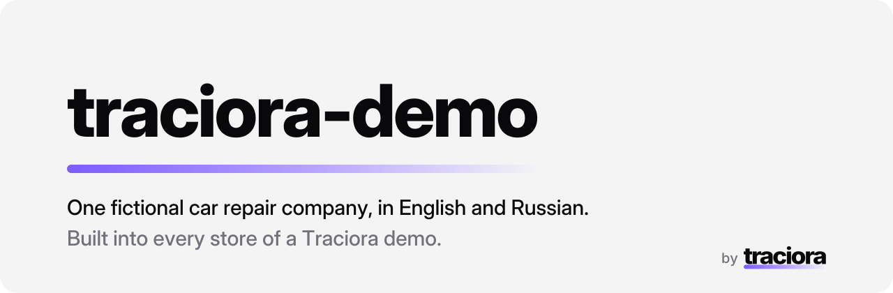
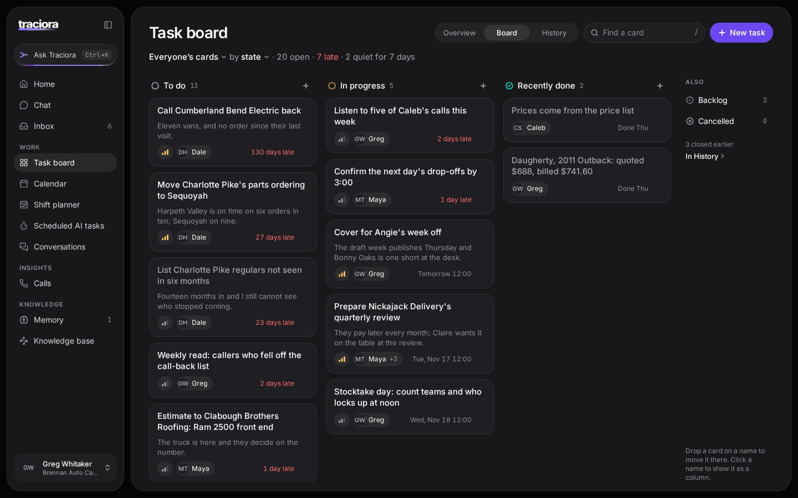
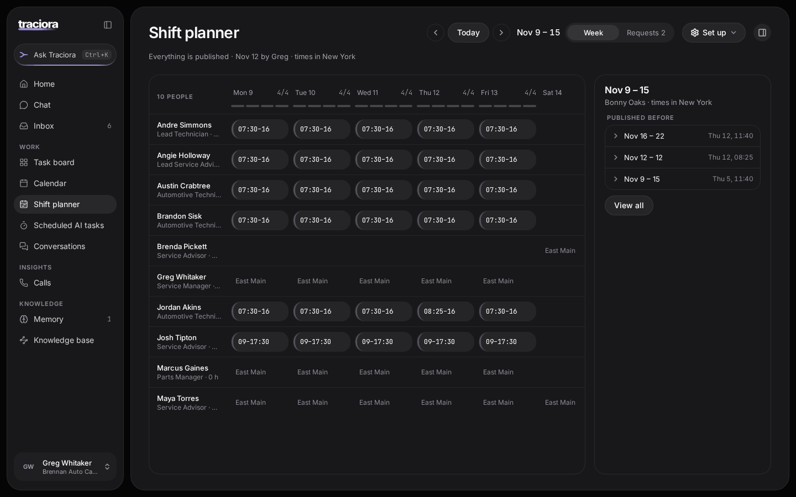
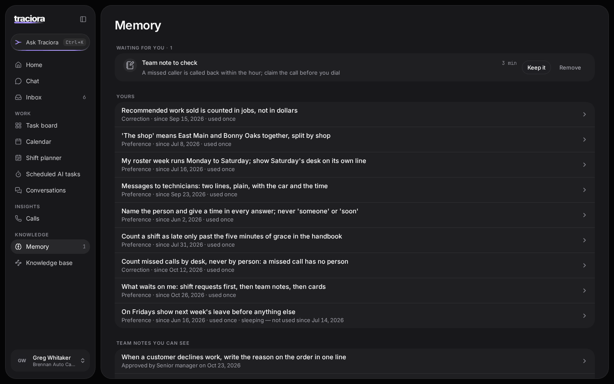
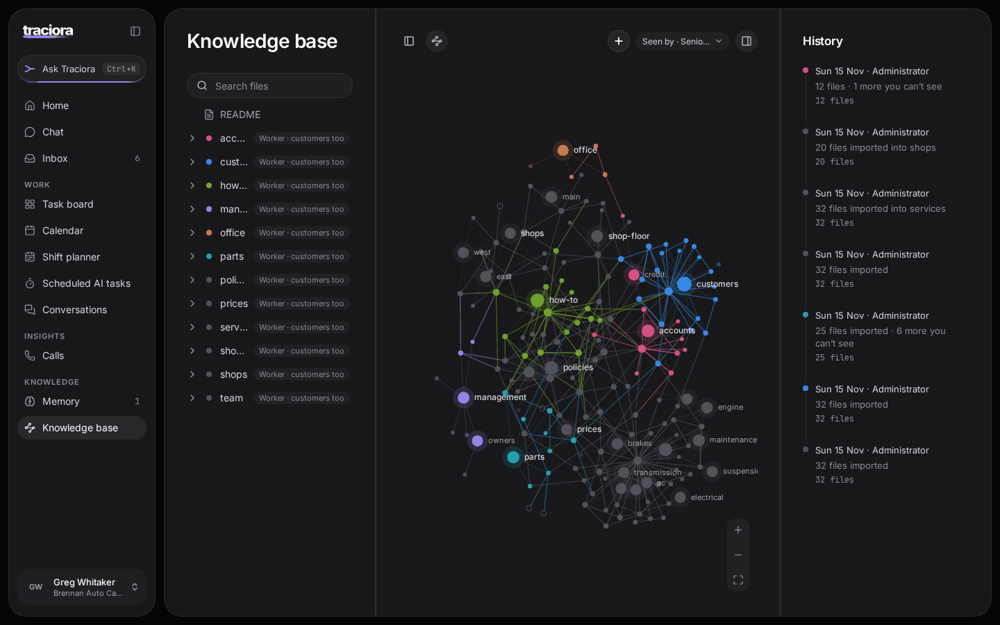
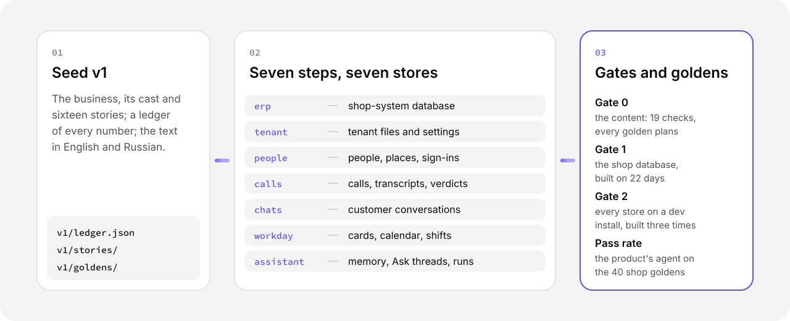
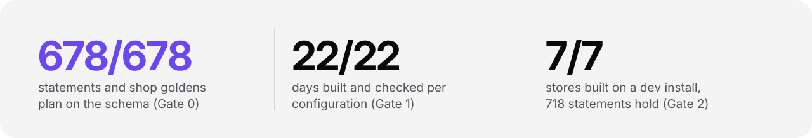

<picture>
  <source media="(prefers-color-scheme: dark)" srcset="docs/assets/hero-dark.svg">
  
</picture>

**traciora-demo is the demo seed of Traciora: one fictional car repair company, designed down to every number, and the seeder that builds a working demo of the product from it.**

Brennan Auto Care runs three shops, two in Chattanooga and one in Nashville, an hour behind. A Russian configuration
tells the same stories in Ulyanovsk and Kazan, written in Russian, not translated. Every figure comes from one
parameter ledger, and the goldens give the expected answers the product is scored against. Nothing here ships in a
customer's release. The company, its people, customers and cars are fictional; a likeness to a real business or
person is chance.

## What the demo looks like

The built demo, signed in as the service manager.

<p>
  
  
</p>
<p>
  
  
</p>

## How it fits together

<picture>
  <source media="(prefers-color-scheme: dark)" srcset="docs/assets/flow-dark.svg">
  
</picture>

A seed version is a folder of plain files: a cast of 33 people, the catalogue, 16 story cards, the 1,140 rows of the
parameter ledger, a shop-system schema of 31 tables, the hand-written calls, chats and pages in both languages, and
the goldens. The seeder reads it and fills a Traciora install in seven steps, in this order, one store each:

| Step | Fills |
|---|---|
| `erp` | the shop-system database the product reads as a connected source: orders, cars, parts, money |
| `tenant` | the tenant's settings, knowledge pages with their dates, playbooks, the source's grants and notes |
| `people` | staff, shops and sign-ins |
| `calls` | the story calls with transcripts and verdicts, read in as the product reads a phone system's call log |
| `chats` | customer conversations, with the assistant's drafts and the open set |
| `workday` | task cards, the calendar, shifts, clock-ins and requests |
| `assistant` | memory, proposals, Ask threads and scheduled-task runs |

A build is dated from its instant T: every story's dates are counted from it, so the demo is current on the day it
is built. Nothing calls a language model at build time.

## Build the demo

On a development install of Traciora, put this checkout beside the product's checkout as `traciora-demo`, or point
`TRACIORA_DEMO_SEED` at it. Setup and start then build the demo tenant from here:

```sh
traciora setup
traciora start --rebuild-demo
```

The seeder also runs on its own, from the product's folder with its Python and environment:

```sh
PYTHONPATH=<this checkout> .venv/bin/python -m seeder demo --cfg en --client-id demo --replace
```

[`seeder/README.md`](seeder/README.md) has every step, option and check.

## Gates

<picture>
  <source media="(prefers-color-scheme: dark)" srcset="docs/assets/stats-dark.svg">
  
</picture>

Three gates decide whether a seed commit is good. Their lines at `ea04fd8`, the last change to the seed's content;
the Russian configuration's lines read the same as the English:

```
SEED GATE v1 ea04fd8 PASS checks=19 explain=678/678 shop_goldens=40+40 kb_goldens=34+43 facts_on_page=all slice1_open=0
SEED GATE1 v1 ea04fd8 en PASS statements=299/299 goldens=40/40 days=22/22 ...
SEED GATE2 v1 ea04fd8 en PASS stores=7/7 statements=718/718 ... repeat=same
```

| Gate | Proves | Run |
|---|---|---|
| Gate 0 | the content: 19 checks agree, every statement and shop golden plans on the schema, every knowledge-base fact is on its page | `v1/checks/gate.py` |
| Gate 1 | the shop database: built on 22 days, under three random seeds and once more as a repeat; every statement and golden holds | `seeder/gate1.py` |
| Gate 2 | every store, on a dev install: built three times, every store's statements hold, the repeat writes the same | `seeder/gate2.py` |

The product's agent answers 20 of the 40 shop goldens in English and 21 of 40 in Russian
([`pass-rate.en.json`](v1/evals/pass-rate.en.json), [`pass-rate.ru.json`](v1/evals/pass-rate.ru.json)). Each failure
is kept there with its cause and the agent's last query.

## Layout

| Path | Holds |
|---|---|
| `v1/` | seed v1: the ledger, cast, catalogue, stories, the text of every store in both languages, the goldens, the eval sets, the checks |
| `seeder/` | the code that builds a demo from a seed version, and gates 1 and 2 |
| `docs/` | the [design](docs/design.md) and the [research](docs/research/) behind the numbers |

## Versions

A seed version is the whole of: the business and cast, the stories, the parameter ledger, the shop-system schema and
the text in both languages. An eval set names the seed version it runs on; this is eval set v1.0 on seed v1.

| Change | Version |
|---|---|
| an existing expected answer changes | next major |
| stories or questions are added and no existing answer changes | next minor |
| wording fixed, no answer changes | patch |

## Documentation

[Design](docs/design.md) · [Seeder](seeder/README.md) · [Story cards](v1/stories/README.md) ·
[Eval questions](v1/evals/README.md) · [What v1 does not hold](v1/PENDING.md)

Made by [Traciora](https://traciora.com).
